# Blue Tea

Blue Tea is a full-stack café website with a digital menu, table reservations, and a tea and coffee shop. Visitors can browse products and articles, save favorites, and manage their reservations. Staff use a separate admin panel to manage menu items, products, content, bookings, and users.

## Screenshots

### Home

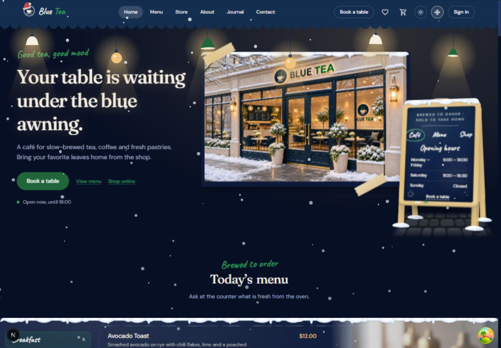

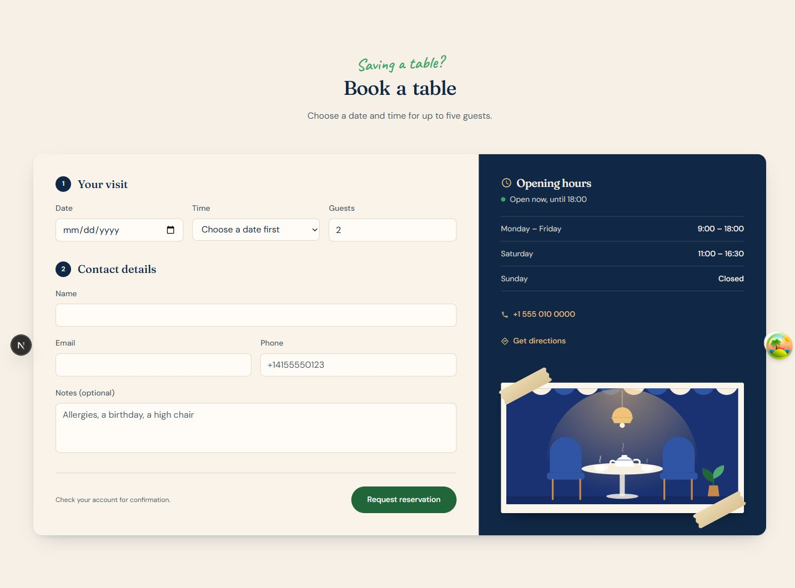

More from the homepage

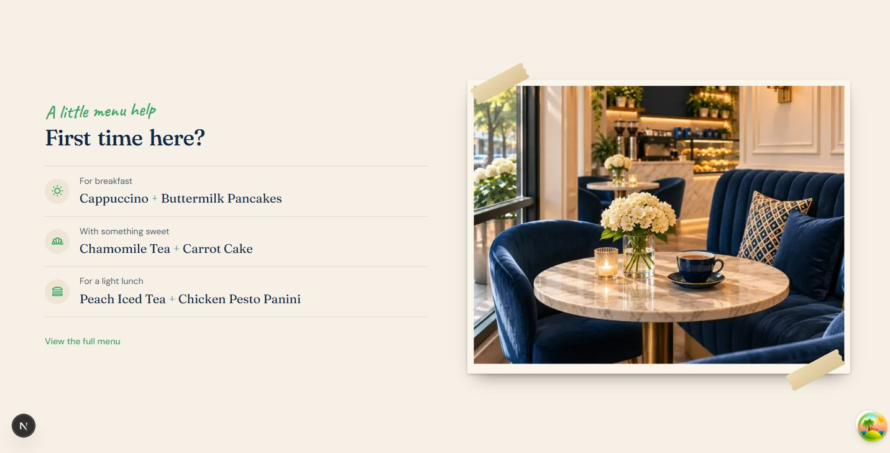

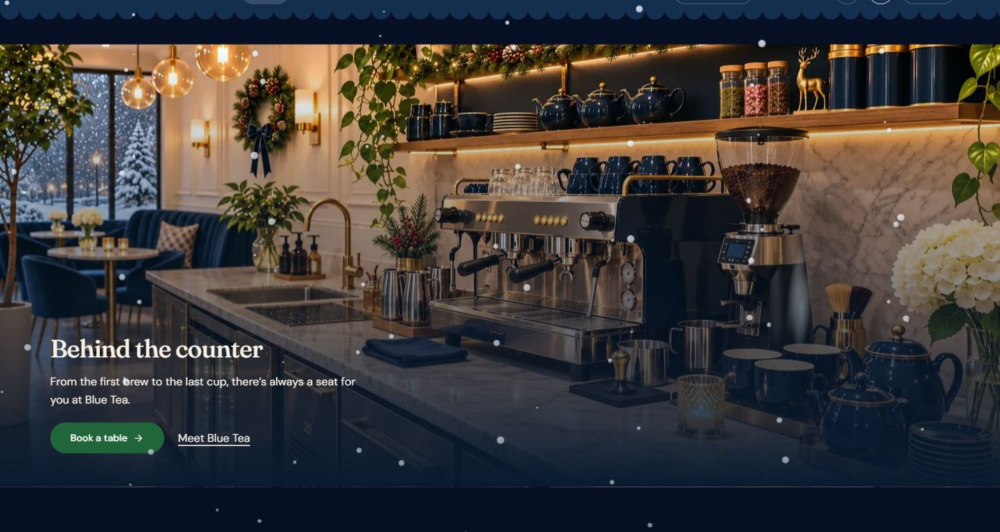

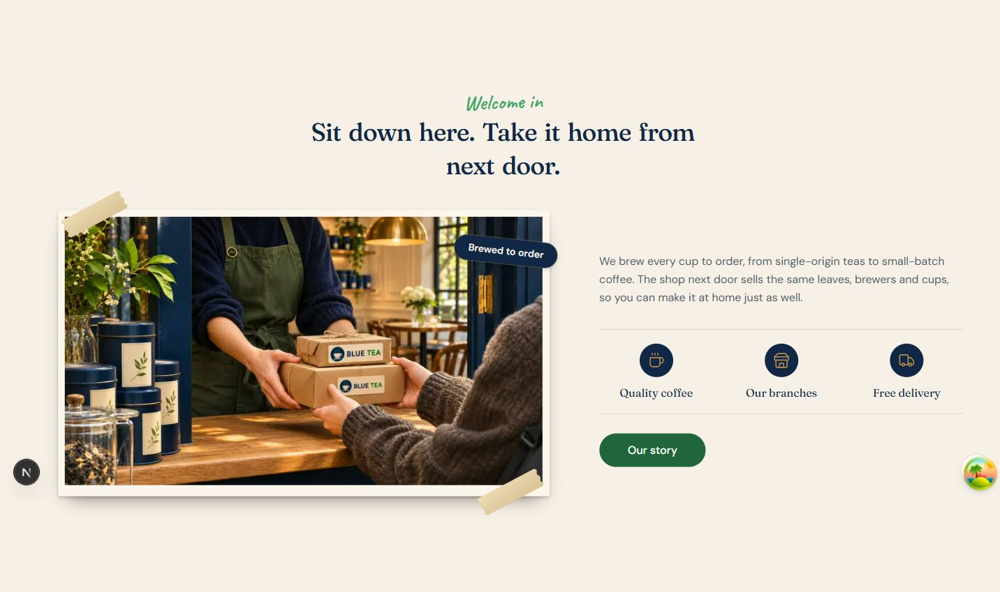

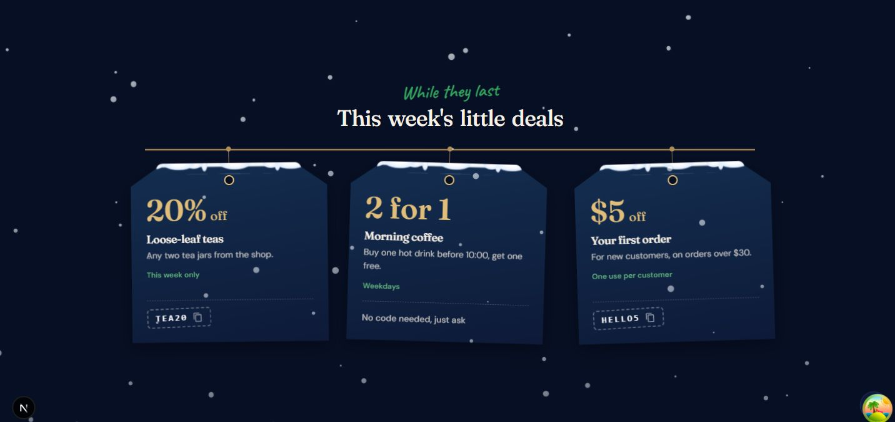

Shop, journal, and about

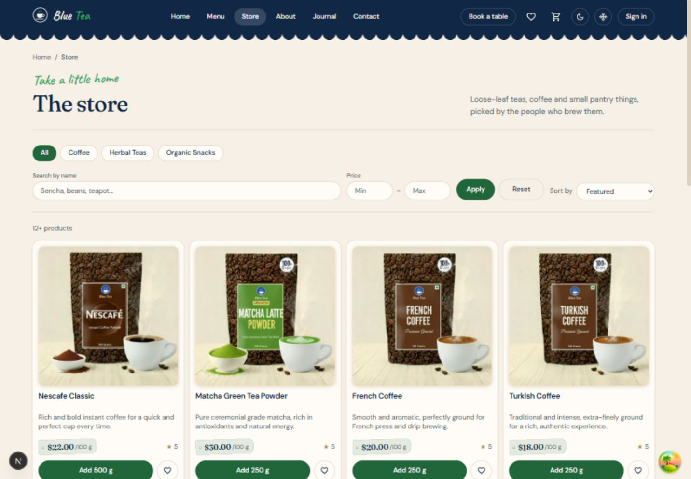

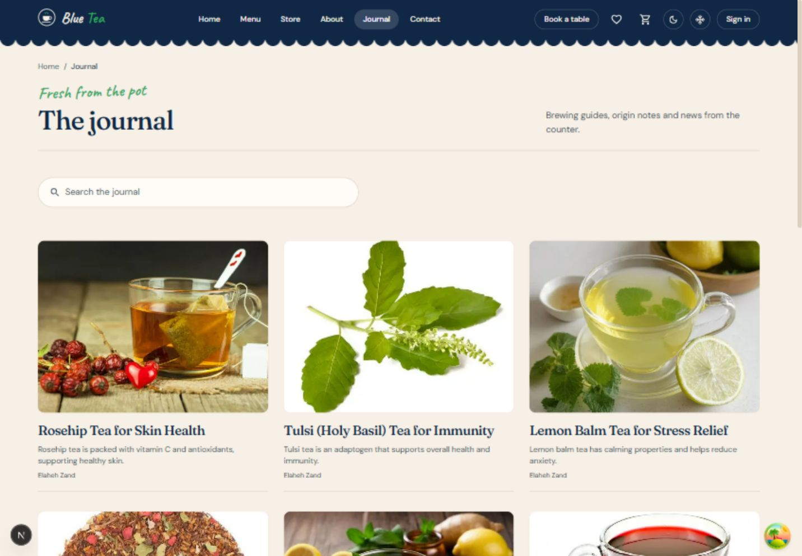

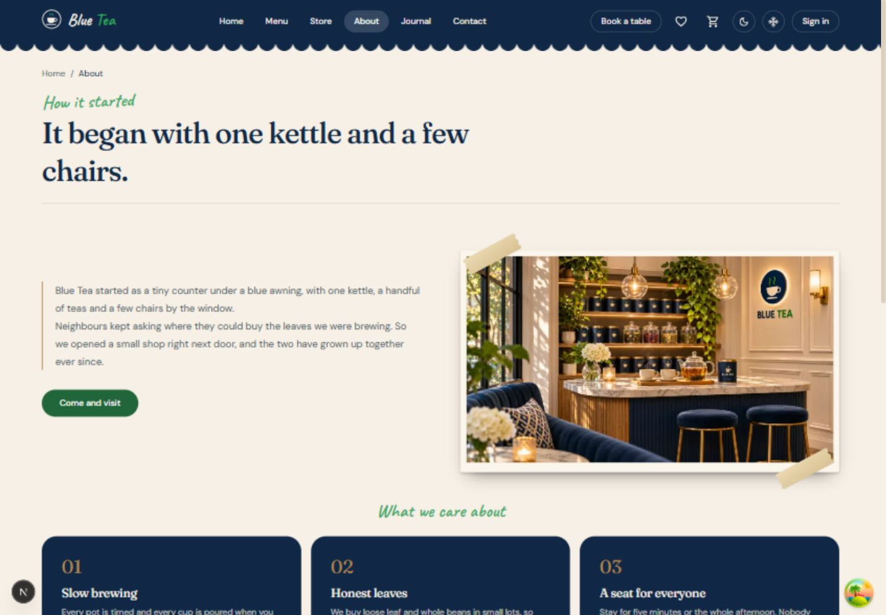

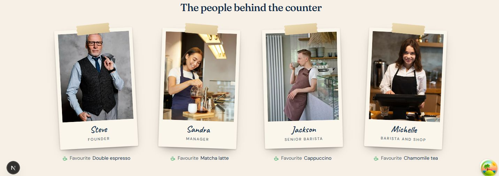

Customer and admin dashboards from an earlier revision

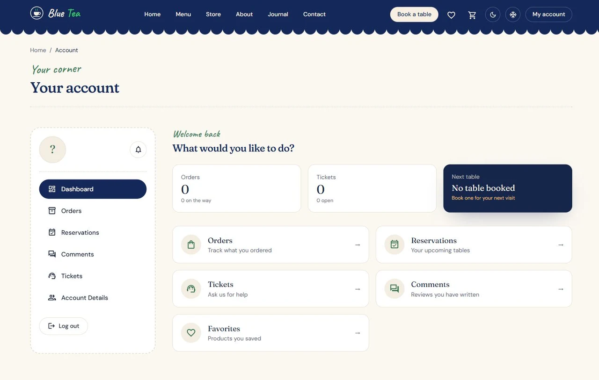

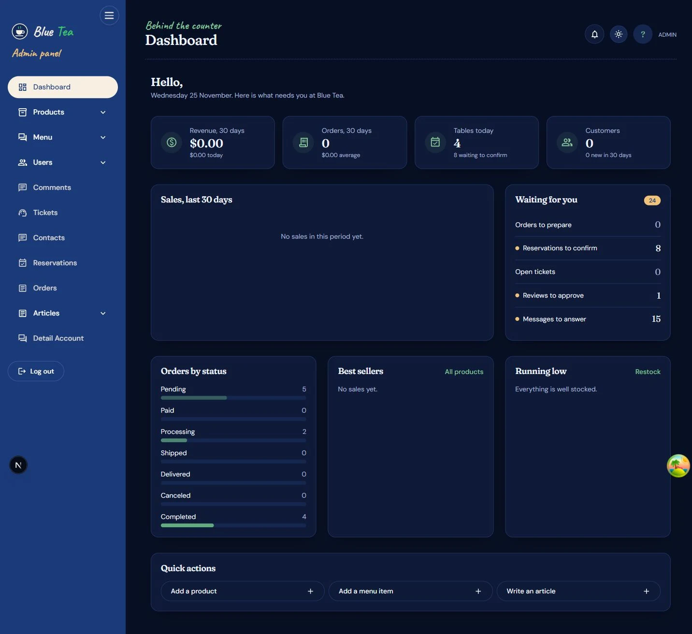

## Features

- **Café** — browse the menu by category and request a table in a half-hour slot during opening hours.
- **Shop and journal** — browse products, save favorites, read articles, and leave reviews.
- **Customer account** — sign in with an SMS code, edit a profile, and view reservations and notifications.
- **Admin panel** — manage the menu, catalog, articles, comments, reservations, and users.

Server-side cart, order, and support ticket workflows are still in development.

## Tech stack

- `client/` — Next.js, React, TypeScript, Tailwind CSS, and TanStack Query.
- `server/` — Node.js, Express, TypeScript, MongoDB with Mongoose, and Redis.

## Local setup

1. Start MongoDB and Redis. Use Node.js 22 or later and npm.
2. In `server/`, copy `.env.example` to `.env`, replace the token secrets, and run `npm ci` followed by `npm run dev`.
3. In `client/`, copy `.env.example` to `.env.local` and run `npm ci` followed by `npm run dev`.
4. Open http://localhost:3000. The API health endpoint is http://localhost:4000/api/health.

Phone sign-in requires IPPanel credentials and Redis. See the [backend guide](server/README.md) for configuration.

## Checks

- In `client/`, run `npm run lint`, `npx tsc --noEmit`, and `npm run build`.
- In `server/`, run `npm run typecheck` and `npm run build`.

Set `NEXT_PUBLIC_API_URL` to the deployed API base URL, including `/api`, and `NEXT_PUBLIC_SITE_URL` to the public frontend URL. Set the backend `CLIENT_URL` to the frontend origin. Image requests under `/uploads/` are forwarded to the API origin. Use the same IANA time zone for `RESERVATION_TIME_ZONE` on the server and `NEXT_PUBLIC_RESERVATION_TIME_ZONE` on the client.
